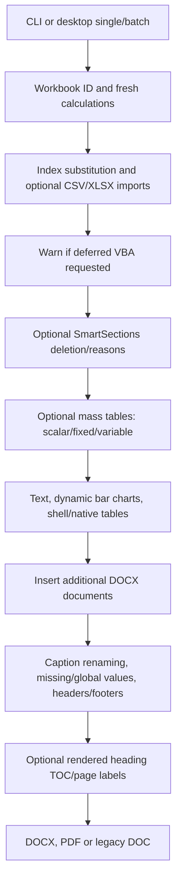

# Report Writer: conversion scope and implementation review

Engine 0.2.0 implements the main reporting execution paths in Python. It consumes
original XLSM/XLSX configuration, imports data, calculates formulas, assembles the
Word template and finalizes heading contents tables/exports. There is no C++
component and no Excel/Word automation in this engine. Keeping a VSTO ribbon as
an eventual front end is still possible; that bridge has not been built.

This is not complete behavioral parity with every Interop operation. The ledger
records every original declaration and its specific implemented behavior, evidence,
exclusion or remaining gap. “Partial” means working replacement functionality with
an identified compatibility limit, not that its execution path was skipped.

## User scope decisions

- Access identity/license/logging and associated EncryptX routines are excluded;
  authentication will be designed separately. No database records or key material
  are published or consumed by the Python engine.
- Killing stray Word processes is excluded. The engine does not start Word.
- `TRW.AddMacros` executes users' boutique VBA queries in the original environment.
  VBA execution is deferred for now. B33 On produces a visible warning; it does
  not claim those queries ran. A separate Python extension callback is available.
- SmartSections, CommonCore/index substitution/imports, single/batch reports,
  mass tables, main population, additions, caption numbering, headers, missing
  values, global replacement and report export remain required and implemented
  for the supplied contracts. Compatibility limits remain explicit below.
- The user requested a corrected example copy. Originals remain unchanged; the
  [fixture notes](../examples/legacy/README.md) list all changes to that copy.

## Source provenance and complete inventory

The authoritative source inputs are `Report Writer 4.0 010824.zip` and
`The Report Writer Package 01092025.zip`, preserved outside the checkout.
[legacy-inventory.json](legacy-inventory.json) retains hashes, original line
locations, signatures, formula expressions/formats, charts, fields and tab metadata.
The original Python draft was commit `26ab3a4`; this review describes version 0.2.0.

| Inventory | Count | Coverage |
|---|---:|---|
| Compiled VB.NET source files / lines | 19 / 5,758 | Exact project Compile-entry match, including generated files |
| VB.NET declarations | 159 | 108 Subs, 39 Functions, 9 Properties, 3 Win32 declarations |
| Non-designer / generated declarations | 126 / 33 | Both kept in ledger |
| Original XLSM workbooks | 3 | Individually inventoried; blank shell, finished, advanced |
| Worksheet occurrences / distinct names | 65 / 26 | Hidden sheets included |
| Formula cells | 641 | 186 blank, 202 finished, 253 advanced; original copies counted separately |
| Extracted VBA modules / declarations | 72 / 9 | Most are empty sheet/document stubs; 6 distinct procedure names |
| Ledger rows | 168 | Every VB declaration plus every VBA occurrence |

Conditional declarations are included conservatively. AssemblyInfo has no routines.
Uncompiled designer stubs and generated obj files are recorded as excluded paths,
not omitted application modules. VBA was extracted/read, not executed. The old
ProcessReports macros launch `Report Writer Kernel.exe`, absent from the package;
their handoff protocol remains unported even though direct Python single/batch
execution is available. Source/binary identity is separate from a reproducible build.

## Current declaration statuses

| Status | Rows | Meaning |
|---|---:|---|
| Complete | 5 | Narrow original behavior contract implemented and acceptance cases verified; no listed gap for that routine |
| Partial | 78 | Implemented replacement with the specific compatibility gap listed in its row |
| Replaced mechanism | 22 | Clipboard/COM/HTML cleanup or resource mechanism replaced by direct file operations; output fidelity inherits relevant feature limits |
| Review candidate | 17 | Empty/diagnostic/older alternative retained; not silently declared unused or retired |
| Host-specific | 33 | Generated VSTO/.NET support; needed only if preserving that host and not counted as Python parity |
| Excluded by user | 12 | AccessX/EncryptX declarations and KillWord |
| Deferred by user | 1 | Boutique VBA AddMacros |

These counts are declarations, not percentages of product usefulness. The
[function ledger](FUNCTION_LEDGER.md), [CSV](conversion-ledger.csv) and
[JSON](conversion-ledger.json) have purpose, original location, replacement,
remaining gap and verification evidence. Reviewed updates are maintained in
[conversion-updates.json](conversion-updates.json); source metadata remains immutable.

## Implemented execution path

`ReportWorkbook` loads formulas, not cached values. Imports clear/copy configured
rectangles, including blanks, honoring source/destination offsets. CSV and XLSX
sources are supported; formulas in XLSX input also evaluate freshly. The supplied
workbook functions (IF, SUM, COUNTA, COUNTIF, CONCATENATE, LOWER, TEXT, OR, TODAY,
DAY, MONTH, YEAR, LOOKUP, VLOOKUP), operators, cross-sheet references and named
ranges are supported. Unknown functions/circular formulas report a cell-specific
failure. This is not arbitrary Excel calculation; external/array/whole-column
references and broad locale/format behavior remain unsupported.

The original three table paths are addressed as follows:

1. Existing Word shell: fixed/variable data rows, shell formatting preserved,
   explicit failure if fixed data would truncate, table metadata supplied.
2. `Table Convert`: native DOCX table with merged cells, fonts, colors, fills,
   borders, alignment, dimensions, repeating headers, padding and metadata.
3. Excel HTML branch: native DOCX replacement using the same formatting inputs.
   The clipboard/HTML transport is removed. Exact conditional formatting and
   unusual Excel HTML presentation are not certified equivalent.

The supplied old domain-specific bullet transformations have opt-in Python
implementations and tests. Their old import dispatcher was commented out, so
normal imports do not invent a new automatic bullet step. Workbook narrative
formulas/table output remain active.

## TOC, page numbers and the update prompt

The original `RunReport1` updates its first TOC when B25 is On. The earlier Python
prototype merely set `updateFields=true`, which requested manual updating on
opening. That incomplete behavior has been replaced for heading-based templates.

The new renderer exports a PDF through LibreOffice's supported headless CLI,
reads actual heading bookmarks/page labels, rebuilds the cached TOC and PAGEREF
results/bookmarks in DOCX, and renders again until entries stabilize. It verifies
final headings/pages before publishing. It preserves template TOC styles and
sets `updateFields=false`; it does not ask Word to finish the report. Tests change
headings and add enough content to change pagination, then compare final caches
against the rendered PDF. PDF and legacy DOC output are available through the
same renderer. Pure assembly requires no renderer when B25 is Off.

Support currently covers one heading-based TOC using the supplied `\o` range
and `\h`, `\z`, `\u` switches. Custom switches/multiple TOCs fail explicitly.
Arbitrary non-TOC fields are not a complete replacement for Word field evaluation.
LibreOffice pagination may differ from Word and depends on fonts. Final DOCX/PDF
headings/pages are checked; legacy DOC format is smoke-tested, but its own
re-imported pagination is not separately certified. Choosing `--skip-fields`
explicitly produces unfinished cached page numbers with a warning.

## Remaining gaps and where user examples can help

| Area | Implemented now | Still unresolved |
|---|---|---|
| Chart conversion | Named clustered/standard bar charts, horizontal/vertical, multiple series, fresh ranges, source dimensions fitted to page/cell width and alt overrides | Other types/groupings fail; Excel chart theme/labels/fidelity need representative chart examples |
| Native/HTML table fidelity | Merge/style/border/font/header/padding branches, corrected merged gender table | Conditional formatting, exact width/height behavior and complex premerged shells need real templates |
| SmartSections | Include/delete/reason, body table deletion, bullet modes | Markers spanning separate table cells/nested Word ranges are unsupported |
| Additional documents | Style/relationship-aware insertion including images; missing-file message | Body paragraph anchors required; separate inserted-document header/footer policies remain partial |
| Headers/Word stories | Five section texts/alignments, direct paragraph/table text, cross-run literal replacement | First/even-page headers, text boxes, tracked changes and broader Word-range matching lack parity evidence |
| Workbook breadth | All original 641 formula cells evaluate freshly; per-ID imports checked | Arbitrary Excel/VBA, legacy .xls, locale/type inference and drawing/extension preservation on prepared-workbook roundtrip |
| Desktop/host | CLI checked; Tk controls/progress and Windows launcher implemented | Windows UI/launcher interaction untested; no signed executable installer, ribbon bridge or cancellation UI |
| Older alternate routines | Active equivalent outcome paths implemented; all originals listed | Alternate importers, Changeheader2's absent Header tab, unfinished DoubleQuotes and MySQL diagnostics need explicit retirement/compatibility decisions |

Only supported inputs are intended to generate successfully; detected unknown
formats/types/options fail or report the explicit deferred behavior. Some uncommon
styling can still be approximated, so visual review remains necessary. The blank
shell's empty Summary Sheet is retained as configurable data; no absent business
statistics were invented. Original fixed-A filenames in the simple workbook are
preserved even for B; only the separate corrected advanced copy fixes agreed
example issues.

Outputs refuse overwriting and use unique owned temporary resources. Batch failure
can leave prior successfully published reports. Demo Mode On reports progress and
warns that there is no live Word window. Accessibility metadata is implemented,
not a Section 508 certification. See [validation](VALIDATION.md) for executed and
unexecuted checks, and [dependencies](DEPENDENCIES_AND_DEPLOYMENT.md) for deployment.
