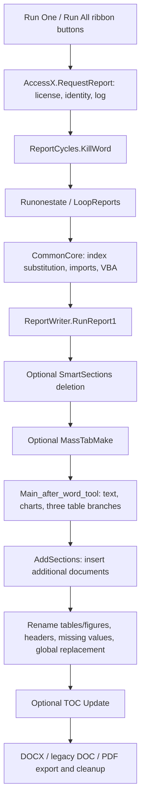

# Report Writer: full conversion scope and current audit

This document defines the entire conversion scope. It does not claim the
conversion is complete. The user requires every function and workbook feature
to be accounted for; any held or retired behavior must be explicitly flagged.

The implementation target is **Python**, with a document engine and separate
workbook/configuration and rendering adapters. There is no C++ layer. The Excel
ribbon may remain a front end; retaining it is compatible with this architecture.
Replacing VB with C# or C++ is not a prerequisite. A renderer may be required for
final pagination, field calculation, and PDF export; that is an explicit hold,
not an excuse to substitute a manual user operation.

## Read this first

The prototype is **not a line-by-line or complete behavioral port**. Its eight
Python functions implement generic document assembly and an example CSV/JSON
adapter. The example mapping is handwritten from the supplied workbook; the
engine does not yet consume the workbook itself.

**Zero original routines are currently certified Completely converted.** Fifteen
have partial replacement functionality. Passing the four current tests does not
establish full routine, workbook, or application parity. The user's successful
Windows CLI run establishes that the prototype runs on Python 3.11.9 and writes
reports there; it does not close the remaining feature gaps.

The original `RunReport1` does call `TablesOfContents(1).Update()` when Current
Parameters B25 is On. The Python engine instead writes `w:updateFields=true`.
That requests an update when Word opens; it does not calculate TOC page numbers
and caused the user's update-fields prompt. This is **not equivalent behavior**.
Manual TOC refresh is not accepted as the completed application's solution.

## Audited materials and completeness

The two original uploads are the authoritative audit inputs:

- `Report Writer 4.0 010824.zip`: the VB.NET project, its source, build outputs,
  obfuscation outputs, signing material, and deployment projects.
- `The Report Writer Package 01092025.zip`: three macro-enabled workbooks,
  input CSV files, Word templates, reference reports/PDFs, Access databases,
  and ClickOnce deployment files.

Archive/file SHA-256 fingerprints and original line locations are in
[legacy-inventory.json](legacy-inventory.json). They identify what was reviewed
without publishing source secrets, private signing files, or database records.
The prototype baseline is commit `26ab3a4`.

| Inventory | Count | Meaning |
|---|---:|---|
| Compiled VB.NET source files | 19 | Exact match against all project Compile entries |
| VB.NET source lines | 5,758 | Includes comments, blank lines, and generated code |
| VB.NET declarations | 159 | 108 Subs, 39 Functions, 9 Properties, 3 Win32 declarations |
| Non-designer declarations | 126 | Includes app routines, events, exception constructors, empty stubs, and Win32 declarations |
| Generated designer/support declarations | 33 | Kept in the ledger; not silently discarded |
| Supplied XLSM workbooks | 3 | Each workbook inventoried independently |
| Worksheet occurrences / distinct names | 65 / 26 | Includes hidden tabs |
| Workbook formula cells | 641 | 186 blank shell, 202 finished example, 253 advanced demo; copies counted separately |
| VBA modules / declarations | 72 / 9 | Modules include document/sheet stubs; 6 distinct routine names, with repeated copies |
| Function ledger rows | 168 | All 159 VB.NET declarations plus 9 VBA occurrences |

Declarations in conditional-compilation branches are included conservatively;
these counts describe declarations in compiled source files, not a runtime trace.
The inventory records all 641 formula expressions with cell addresses and number
formats, as well as the Excel chart types and series references. Cached calculated
values are not treated as fresh calculations.

The archive also has build-generated `obj` VB files and an uncompiled top-level
designer stub. Their paths are explicitly recorded as excluded VB entries;
they are not additional application modules. No compiled source file was omitted.
AssemblyInfo is included with zero routines.

VBA was extracted and read, not executed. Only three modules across the workbooks
contain routine declarations: two copies of `ProcessReports.bas`, and `TRW.bas`
in the advanced demo. The remaining extracted modules contain no procedures.
The older macros reference `Report Writer Kernel.exe`; that executable is not
present in the supplied package. This old interface is tracked separately from
the working VSTO ribbon path.

See the complete [function ledger](FUNCTION_LEDGER.md), the
[sortable CSV](conversion-ledger.csv), and [workbook tab catalog](WORKBOOK_TABS.md).

## Status definitions and current counts

| Status | Rows | Meaning |
|---|---:|---|
| Complete | 0 | Original behavior, data/configuration contract, and acceptance cases verified; no outstanding parity gap |
| Partial | 15 | Related Python functionality exists, but listed original behaviors remain missing |
| Not converted | 64 | No equivalent implemented and tested |
| Held | 19 | Explicitly pending a named compatibility/architecture dependency; remains in scope |
| Replacement pending | 12 | Desktop/COM mechanism should be replaced by a verified equivalent outcome; not yet closed |
| Review candidate | 25 | Diagnostic, empty, alternate, or apparently older code; retirement is not approved or assumed |
| Host-specific | 33 | Generated VSTO/.NET support; preserve with a retained ribbon or explicitly replace/retire with host change |

These are declaration counts, not percentages of product usefulness or effort.
Each row has a responsibility, original location, available Python replacement,
and a concrete gap. The JSON also retains original signatures, hashes, and
static reference candidates. Static scans cannot prove dynamic reachability,
resolve every VB overload/global binding, or show that an older routine is unused.

## Actual legacy execution paths

The ribbon contains **Run One Report**, **Run All Reports**, **One Time Import**,
and **Chart ID**, organized under Run Reports, Import, and Tools groups. Empty
startup/load events and the processing form are inventoried separately.



The One Time Import button calls `JustImportMe3`, rather than the full licensed
report pipeline. Full report auto-import calls `CallFigures`, which additionally
updates named Excel chart ranges. These differences must not be collapsed without
an explicit compatibility decision.

`Main_after_word_tool` has three table paths:

1. Report Numbers T true: fill an existing Word table shell; U controls variable
   versus fixed rows.
2. T false and U equals `Table Convert`: build a native Word table copying Excel
   merged cells and detailed cell formatting.
3. Otherwise: publish Excel range as HTML, rewrite padding/conditional markup,
   insert it into Word, and apply layout/accessibility settings.

The prototype's single basic table generator is not equivalent to all three.
The old clipboard/HTML workarounds can be replaced, but the resulting formatting
and behavior must be preserved and tested.

## Named holds — nothing is silently left out

| ID | Behavior held | Why / current evidence | How the hold closes |
|---|---|---|---|
| H01 | Automatic TOC, PAGEREF/page numbers, pagination, final PDF | python-docx and Matplotlib do not provide Word's layout engine. Only a LibreOffice compatibility export was tried; no field-refresh/PDF adapter or parity contract exists. | Select and test a renderer; refresh fields after edits, repaginate, verify resulting page references/PDF, and surface failures without user repair steps. Word automation would require an explicitly labeled Windows compatibility mode. |
| H02 | Workbook loading, recalculation, dynamic ranges, arbitrary formulas, VBA hook | No workbook adapter exists. 641 formula cells are recorded. openpyxl can read/write formulas but does not evaluate them. Supplied TRW.AddMacros is empty; user-defined future bodies are an extension contract. | Implement a workbook data model and defined formula support or explicit calculation adapter; detect unsupported formulas/macros, never silently use stale cached values. Verify both supplied examples and advanced demo; decide retained Excel/VBA compatibility separately. |
| H03 | License verification, strict/non-strict user permissions, Access logging, encryption compatibility | Production ribbon gates on AccessX and EncryptX; Python prototype omits the gate entirely. Source confirms schema names, not actual database contents or valid license fixtures. Current date/locale affects legacy crypto derivation. | Read schema with suitable Access tooling, establish authorized fixtures and expected outcomes, implement compatible policy/storage or document an approved migration. Do not bypass licensing to claim parity. |
| H04 | Ribbon/progress UI, chart-name tool, old workbook-to-kernel macros, desktop packaging | CLI exists; ribbon integration/UI/installer do not. Old macros launch an absent kernel executable. | Implement retained-ribbon bridge or chosen UI and installer, with explicit statuses for the old kernel route; validate buttons, reporting progress, cancellation/errors, and Windows install. |
| H05 | Legacy `.doc` export | Original has DOCX/DOC/PDF branches; Python generates DOCX only. | Add a renderer-backed conversion and test legacy DOC, or obtain an explicit retirement decision. |

Holds mean **required behavior is currently unresolved**, not approved exclusions.
Independent conversion work can proceed while they are open. Candidate junk code
stays cataloged until source/call evidence and user requirements justify retirement.

## Current Python behavior and evidence

| Python routine | Implemented now | Existing verification / limits |
|---|---|---|
| `engine.paragraphs` | Enumerate document paragraphs and existing header/footer parts, including table paragraphs | Header/table tests; no broad text-box, hyperlink-run, tracked-change, or content-control parity suite |
| `engine.replace_text` | Literal tag replacement across direct runs, keeping surrounding formatting and first-tag-run format | Split/repeated/prefix-overlap tests; legacy matching is case-insensitive, new matching is case-sensitive |
| `engine.chart_image` | Render a vertical bar chart to PNG with Matplotlib | Two example charts render; no fidelity comparison with Excel chart styles/types |
| `engine.insert_table` | New rectangular table, explicit widths, one repeating header row, caption/description metadata | Example values/total checked; no legacy merge/border/font/padding matrix |
| `engine.bullet_numbering` | Real Word bullets instead of Wingdings glyphs | Example narrative checked; no conversion of three domain-specific bullets.vb routines |
| `engine.render` | Populate configured elements; preserve sections/page breaks; reject unmapped tags/overwrite; save DOCX | Four tests pass; sets updateFields instead of updating fields; block elements require standalone paragraph tags |
| `cli.resolve` | CSV dictionaries, per-report filenames, sum-column values, basic charts, templated bullet sentences | Example A/B checked; no Excel offsets, formula interpreter, workbook styles, or legacy numeric-format compatibility |
| `cli.main` | Individual/batch manifest reports and output selection | CLI executed on Linux and by user on Windows; manifest IDs replace workbook loop list; no desktop UI |

The prototype changes some behavior deliberately, but those changes must be made
visible before full migration: case-sensitive/narrower tag recognition, refusal
to overwrite output, unknown-tag failures, real bullets instead of table-based
bullet glyphs, fixed table layout choices, and new chart styling. Legacy behavior
should be the default reference; intentional differences need a compatibility
setting or explicit acceptance rather than silent changes.

The Company B example selects B inputs and totals 3 employees. The supplied
simple workbook had fixed A filenames and its B reference document totals 30.
Preserve the reference as evidence, but do not turn this configuration mismatch
into an expected data-calculation result. The advanced workbook already selects
filenames from the current report ID.

## Full conversion delivery sequence

1. **Inventory and contracts:** this audit, source provenance, routine/tab ledger,
   option mapping, known deviations, and acceptance matrix. No runtime parity
   improvement is claimed merely for writing documentation.
2. **Workbook preparation:** read all mappings and flags; import CSV/XLSX ranges;
   handle formula calculation, current report ID, chart ranges, index substitution,
   and configurable macro extensions. Reject unsupported cases explicitly.
3. **Document behavior:** port text/format rules, all table paths, chart metadata
   and styling, SmartSections, insert-document rules, headers/footers, renumbering,
   global replacements, and missing-value transformations.
4. **Finalization:** implement H01/H05 rendering/export and complete automated
   report output without manual field refresh, opening Word, or cleanup prompts
   in the selected Office-independent mode.
5. **Policy and application:** implement H03 access/logging compatibility, then
   H04 ribbon/UI bridge and packaged Windows deployment. Preserve the current
   VSTO application until the replacement is accepted.
6. **Acceptance:** run the feature cases below, inspect layout/accessibility,
   and update every ledger row. Any retirement/deferment must be named and
   acknowledged; no unresolved holds may disappear into a passing demo result.

## Acceptance matrix for the complete application

These are required future checks, not claims that they have run.

| Feature group | Required cases |
|---|---|
| Text and tags | Repeated tags; split runs; long text; numeric/currency/percent/date formatting; case behavior; mixed inline content; header/footer/table positions; missing mappings |
| Imports/calculation | CSV quoting/encoding/type coercion; XLSX sources; K source/G destination offsets; blank clearing; dynamic row/column sizes; missing files; ID-dependent formulas; no stale caches |
| Charts | Both supplied charts plus supported legacy types; colors/fonts/labels/dimensions; dynamic source range; exact alt-text override/default branches; image format consistency |
| Tables | HTML-equivalent rendering; existing shell fixed/variable rows; direct-cell conversion; horizontal/vertical merges; per-cell formatting/borders; fit/center/left; multiple header rows; padding and metadata |
| Mass tables | index/index_altered substitution; index_temp; scalar and fixed modes 1/3; variable mode 2; column format parsing; blank-terminated rows |
| Sections and documents | Keep/remove delimiter blocks; nested/table-spanning content; reason text/bullet boundary; existing and missing inserted DOCX; merged styles, numbering, images, and relationships |
| Final document edits | TableX/FigureX renumbering; arbitrary global replacement; all missing-value sentinels; section header/footer alignment; template breaks/margins retained |
| Fields/export | TOC off/on; no unnecessary update prompt; accurate final page references; editable DOCX; legacy DOC if retained; PDF fidelity, links, bookmarks, and relevant accessibility structure |
| Policy/logging | Valid/expired/bad license; strict allowed/denied/unknown user; non-strict registration; one/batch counts; database absent/unreadable; locale/date boundary |
| Application | Single/all/import/chart-ID actions; progress/errors/cancellation; safe owned-resource cleanup; no killing unrelated Word instances; installation on a clean Windows machine |

Completion is behavioral, not one Python function for every VB function. Several
old helpers can map to one robust Python utility. Every original ledger row still
requires a documented outcome, evidence, or explicitly acknowledged retirement.

## Reproducing and maintaining this audit

Audit-only packages: `openpyxl==3.1.5` and `oletools==0.60.2`. They are not added
to the report engine's runtime dependencies. In a separate audit environment:

```sh
python -m pip install openpyxl==3.1.5 oletools==0.60.2
python tools/inventory_legacy.py "path/to/Report Writer 4.0 010824.zip" "path/to/The Report Writer Package 01092025.zip" --output docs/legacy-inventory.json
python tools/write_conversion_docs.py
python tools/write_workbook_docs.py
```

The scanner checks exact compiled-source membership, routine endings, and full
ledger coverage. It does not compile VB or perform an Office runtime trace.
Original code, certificates, credentials, license records, and obfuscation maps
are not copied into this public-facing documentation. Source archive filenames
are preserved; paths inside the inventory identify original locations.

Update the ledger whenever conversion work changes. Mark Complete only with a
named behavior contract and parity evidence; update remaining gaps and holds at
the same time. Record feature validation separately from build/install success.
